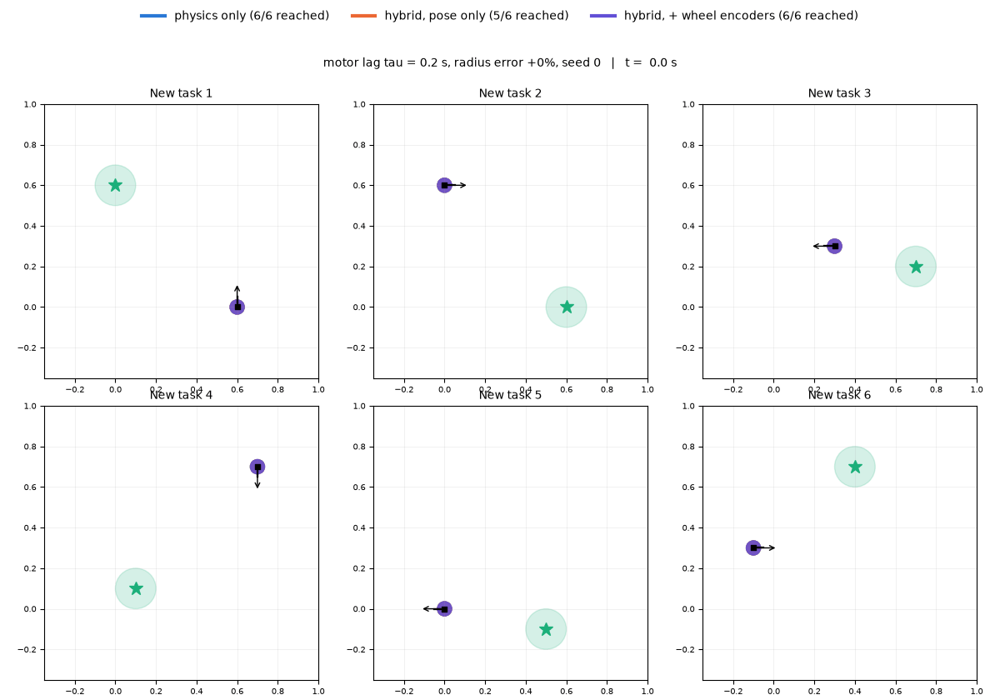
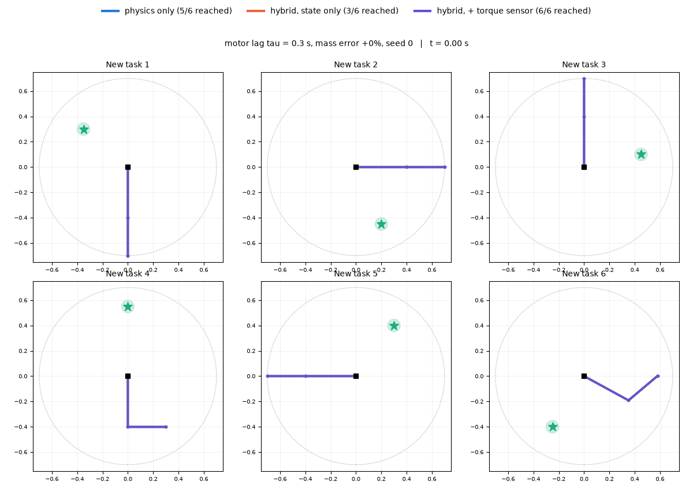

# Sensitivity of Physics-Informed Model-Based RL to Parametric and Structural Model Errors

**When does adding a learned correction to a physics model help a robot, and when does it make things worse?**

Many robot-learning methods use a **hybrid model**: the robot's physics equations plus a small neural
network (the *residual*) that learns what the physics gets wrong. It is usually assumed that the
residual can only help. This project tests that assumption in simulation, on a **two-wheel robot**
and a **two-link arm**, inside a model-based RL loop.

> **Finding:** whether the residual helps depends on **whether the model can see the cause of the
> error**, not on how wrong the physics is.

<p align="center">
  
  
</p>
<p align="center"><em>Exact physics, hidden motor lag. Blue: physics only · Orange: hybrid that sees only the state ·
Purple: hybrid with a sensor for the motor state</em></p>

## The two kinds of physics error

| Error | Example | Can the model see the cause? | Effect of the residual |
|---|---|---|---|
| **Wrong parameter** | wrong wheel radius or link masses | yes | **helps**: success 33% → 85% (robot), 63% → 98% (arm) at +90% error |
| **Hidden motor state** | motor lag; actual wheel speed or torque not measured | no | **hurts**, even with exact physics: success falls to 38% (robot) and 35% (arm) |

**The fix is to give the residual the missing information:**
- a wheel encoder or torque sensor recovers **86–103%** of the loss
- GRU memory, with no extra sensor, recovers **38–82%**, but needs about 4× more data

With both errors together, the state-only hybrid lost to physics in 22 of 24 conditions, while the
sensor version won where the physics was badly wrong (85% vs 35% success on the arm).

All results use 10 seeds and are evaluated on 6 unseen tasks, with paired 95% confidence intervals.

## Setup

- **Robots:** differential-drive robot and two-link arm, simulated in Python/NumPy
- **Models:** physics only, black-box MLP, and hybrid (physics + residual MLP) with different inputs:
  state only, previous command, short history, measured actuator state, or GRU memory
- **Learning:** Dyna-style model-based RL with CEM-MPC planning (15-step horizon)

## Repository structure

```
System1/          Two-wheel robot: Study 1 (wrong wheel radius)
System1/studyB/   Robot: Study 2 (motor lag), Study 2b (input fixes), Study 3 (both errors)
System1/gru/      Robot: GRU-memory residual
System2/          Two-link arm: Studies 1-3, robustness checks
System2/gru/      Arm: GRU-memory residual, offline data check
```

Each folder has `run_*.py` scripts (experiments), `analyze_*.py` scripts (tables and figures) and
`results_*` folders with the saved CSV results.

## Quick start

```bash
pip install numpy torch matplotlib pillow

cd System2
python analyze_arm.py 2        # analyse saved results (no re-run needed)
python run_arm_study2.py       # re-run an experiment (resumable)
python visualize_arm_tasks.py  # make the arm animation
```

Everything runs on a CPU. If a run script stops, run it again and it continues where it left off.

